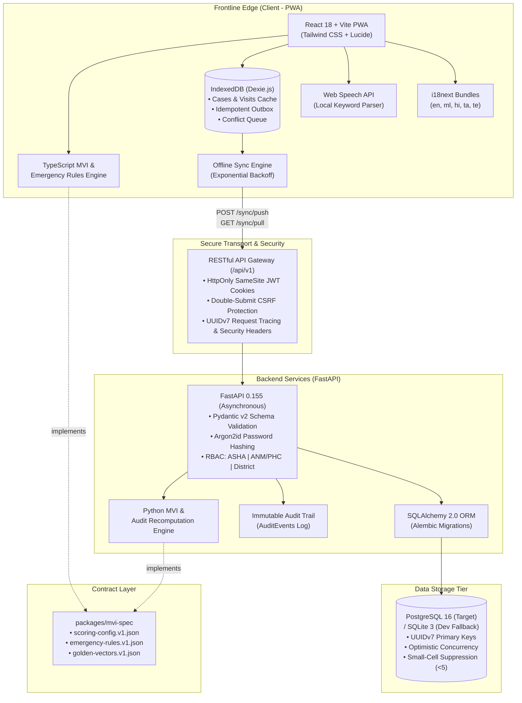
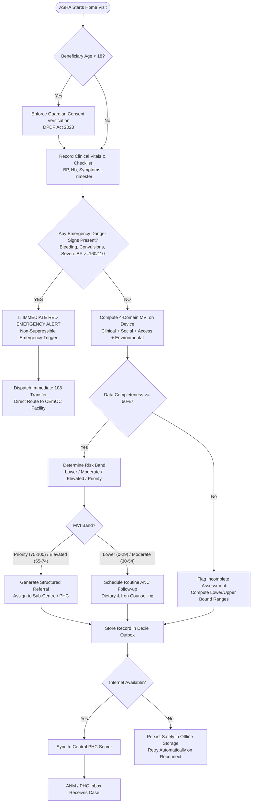
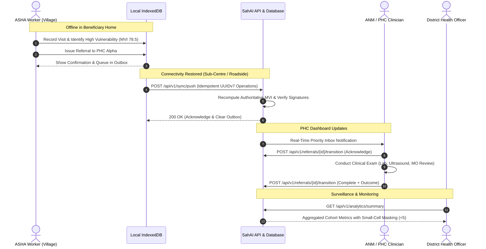

# SahAI (സഹായി) — Maternal Health Decision-Support Co-Pilot

<div align="center">

[](#-project-genesis--status)
[](#-project-genesis--status)
[](#-award--recognition)
[](#-award--recognition)
[](#-license)

**An offline-first, explainable decision-support co-pilot empowering frontline ASHA workers and PHC medical teams to detect maternal vulnerabilities before they become life-threatening emergencies.**

[Key Features](#-core-capabilities) • [System Architecture](#-system-architecture) • [MVI Methodology](#-maternal-vulnerability-index-mvi-engine) • [Clinical Workflows](#-frontline-clinical-workflows) • [Quick Start](#-quick-start--installation) • [Roadmap](#-roadmap)

</div>

---

> [!IMPORTANT]
> ### 🏆 Award & Recognition
> **SahAI won 1st Prize in the "Design for Her" Idea Pitching Competition** hosted by **Government Engineering College (GEC) Barton Hill, Thiruvananthapuram**.
> 
> The project was conceptualized, pitched, and is being actively developed as a **solo initiative by [Ananya Biju](https://github.com/itsananyaaa)**. It represents an ongoing engineering effort to bridge frontline rural healthcare delivery with explainable, privacy-preserving, offline-first assistive technology.

> [!NOTE]
> ### 👩‍💻 Project Genesis & Status
> - **Lead Developer & Creator:** Ananya Biju
> - **Current Phase:** Active Prototype & Technical Validation (Work in Progress / Still in Works)
> - **Clinical Scope:** Point-of-care prioritization & triage support (Aligned with MoHFW PMSMA & WHO MCPC guidelines). *Uses synthetic datasets for demonstration. Not a replacement for professional clinical diagnosis.*

---

## 📌 Executive Summary & Ground Reality

In rural and tribal India, **over 80% of maternal complications and preventable deaths** stem from delays in identification and timely institutional referral (*The Three Delays Model*). The backbone of India's maternal healthcare delivery is the **Accredited Social Health Activist (ASHA)** network—over 1 million dedicated community health mobilizers who visit pregnant women across vast, disconnected geographies.

```
       Frontline Bottlenecks                       The SahAI Solution
  ┌───────────────────────────────┐         ┌─────────────────────────────────┐
  │ Drowning in paper registers   │         │ Fast, structured digital visits │
  │ & disconnected MCP cards      │   ───►  │ with vernacular voice assistance│
  └───────────────────────────────┘         └─────────────────────────────────┘
  ┌───────────────────────────────┐         ┌─────────────────────────────────┐
  │ 0G/2G connectivity in remote  │   ───►  │ 100% Offline-first IndexedDB     │
  │ villages and tribal hamlets   │         │ with background queue & sync    │
  └───────────────────────────────┘         └─────────────────────────────────┘
  ┌───────────────────────────────┐         ┌─────────────────────────────────┐
  │ Overlooking subtle compound   │         │ Explainable 4-Domain MVI Scorer │
  │ risks (clinical+social+env)   │   ───►  │ + Immediate Emergency Triggers  │
  └───────────────────────────────┘         └─────────────────────────────────┘
  ┌───────────────────────────────┐         ┌─────────────────────────────────┐
  │ High referral leakage: women  │   ───►  │ Closed-loop ASHA ◄► ANM ◄► PHC  │
  │ referred but never reach care │         │ live tracking & SLA monitoring  │
  └───────────────────────────────┘         └─────────────────────────────────┘
```

**SahAI (സഹായി — *Helper / Assistant*)** transforms the frontline smartphone or tablet into an intelligent, transparent clinical assistant. It does not replace human clinical judgment with opaque "black-box" predictions; instead, it synthesizes clinical vitals, social determinants, geographical distance, and environmental disruptions into a deterministic **Maternal Vulnerability Index (MVI)** with instant explainability and zero internet dependency.

---

## ⚡ Core Capabilities

### 📴 1. 100% Offline-First by Design
- Operates entirely without network connectivity using **Dexie.js (IndexedDB)** and **Workbox service worker** precaching.
- Full maternal registration, home-visit logging, MVI scoring, and referral drafting work in deep rural dead zones.
- Automatic background synchronization with an idempotent **UUIDv7-backed transactional outbox** when connectivity resumes.

### 🧠 2. Transparent 4-Domain Maternal Vulnerability Index (MVI)
- **Deterministic, rule-based scoring engine** evaluating **Clinical**, **Social**, **Accessibility**, and **Environmental** indicators on a 0–100 scale.
- **Strict missing-data governance**: Generates lower and upper bound confidence ranges; flags incomplete assessments (<60% overall completeness) rather than hallucinating safety.
- **100% TS ◄► Python Deterministic Parity**: Backed by a versioned specification (`packages/mvi-spec`) and verified against golden vectors in both frontend and backend test suites.

### 🚨 3. Non-Suppressible Emergency Escalation Engine
- Evaluates **10 critical maternal danger signs** (e.g., antepartum haemorrhage, convulsions/eclampsia, hypertensive crisis, severe epigastric pain, premature rupture of membranes).
- **Independent bypass logic**: An emergency flag triggers an immediate high-priority facility transfer alert that **cannot be masked or suppressed by a low MVI score**.

### 🤝 4. Closed-Loop Tri-Tier Healthcare Network
- **ASHA Worker Workspace (Mobile PWA):** Consent-first registration, step-by-step visit wizard, tactile numeric steppers, tri-state toggles (Yes/No/Unsure), and voice keyword parsing.
- **ANM / PHC Clinician Inbox:** Priority-sorted triage queue, SLA tracking, clinical case notes, and verifiable referral completion outcomes.
- **District Health Officer (DHO) Analytics:** High-level epidemiological visibility, referral conversion funnels, and **privacy-preserving small-cell suppression (<5 cases masked)** to eliminate re-identification risks in rural hamlets.

### 🌐 5. Multilingual & Frontline-First Design
- Native UI localization across **5 Indian languages**:
  - **English** (`en`)
  - **Malayalam** (`ml` — മലയാളം)
  - **Hindi** (`hi` — हिंदी)
  - **Tamil** (`ta` — தமிழ்)
  - **Telugu** (`te` — తెలుగు)
- Self-hosted typography via `@fontsource` (Noto Sans) for offline typographic fidelity.
- High-contrast charcoal surfaces (`#0B0B0D`) with semantic status indicators (teal, amber, orange, magenta) designed for outdoor readability under harsh sunlight.

### 🛡️ 6. DPDP Act 2023 & Minor Protection Compliance
- Built-in age checks enforcing **mandatory parent/guardian consent capture** for adolescent beneficiaries under 18 years of age per Digital Personal Data Protection (DPDP) regulations.
- Strict MoHFW PMSMA terminology boundaries: ASHA screens display *"Needs priority follow-up / refer to ANM"*, strictly reserving formal clinical diagnoses for Medical Officers.

---

## 🏗️ System Architecture

SahAI is engineered as an enterprise-grade monorepo featuring a decoupled client-server architecture with shared specification contracts.



---

## 🔄 Frontline Clinical Workflows

### 1. Home Visit & Triage Decision Loop



### 2. Multi-Role Closed-Loop Referral Cycle



---

## 📐 Maternal Vulnerability Index (MVI) Engine

The MVI replaces arbitrary intuition with a mathematically transparent, rule-based clinical scoring model based on the **Three Delays Framework** and **Ministry of Health and Family Welfare (MoHFW)** maternal health protocols.

### Domain Weighting Matrix

$$\text{MVI Score} = \sum_{d \in \text{Domains}} \left( W_d \times \text{DomainScore}_d \right) \quad \text{where} \quad \sum W_d = 1.0$$

| Domain | Weight ($W_d$) | Core Indicators Evaluated | Evidentiary Source |
|---|:---:|---|---|
| **Clinical** | `0.25` | Systolic/Diastolic BP, Multi-visit BP trend, Haemoglobin/Anaemia pallor, Prior C-Section, Gestational Age at ANC1 registration | WHO ANC Guidelines & MoHFW PMSMA |
| **Social Determinants** | `0.25` | Maternal Age (Adolescent `<18` vs Advanced `>35`), Parity / Grand Multiparity, Female Education, Household Decision-Making Autonomy | NFHS-5 Maternal Health & Demographics |
| **Accessibility** | `0.25` | Travel time to Comprehensive Emergency Obstetric Care (CEmOC), Ambulance/Transport readiness, Past referral compliance | NHM Emergency Transport Readiness |
| **Environmental** | `0.25` | Road condition / Seasonal flood cuts / Monsoon terrain isolation, Seasonal migrant worker status | Disaster Management & Climate Vulnerability |

### Risk Bands & Clinical Guidance

```
  0                     30                    55                    75                   100
  ┌─────────────────────┬─────────────────────┬─────────────────────┬─────────────────────┐
  │     LOWER BAND      │    MODERATE BAND    │    ELEVATED BAND    │    PRIORITY BAND    │
  │      (0 - 29)       │      (30 - 54)      │      (55 - 74)      │     (75 - 100)      │
  ├─────────────────────┼─────────────────────┼─────────────────────┼─────────────────────┤
  │ Routine ANC follow  │ Nutritional support │ Targeted ANM visit  │ Urgent PHC transfer │
  │ up & IFA compliance │ & BP monitoring     │ within 48 hours     │ & Medical Officer   │
  └─────────────────────┴─────────────────────┴─────────────────────┴─────────────────────┘
```

### Rigorous Missing-Data Handling
Unlike machine-learning algorithms that hallucinate default inputs:
- If a parameter is unknown, the denominator of observed weights dynamically adjusts.
- The system generates an **explicit confidence interval** $(\text{MVI}_{\min} \dots \text{MVI}_{\max})$ assuming worst- and best-case values for missing factors.
- If overall visit data completeness is **$<60\%$**, the output is explicitly labeled as `Incomplete: Provisional`.

---

## 🗂️ Monorepo Structure

```
Sahai/
├── apps/
│   ├── api/                           # Backend FastAPI Application
│   │   ├── alembic/                   # Database schema migrations
│   │   ├── app/
│   │   │   ├── api/v1/                # Versioned REST endpoints (auth, cases, sync, etc.)
│   │   │   ├── core/                  # Security (Argon2id, JWT), exceptions, middlewares
│   │   │   ├── models/                # SQLAlchemy 2.0 ORM models (UUIDv7, audit logs)
│   │   │   ├── mvi/                   # Python MVI Scorer & Emergency Rules Engine
│   │   │   ├── schemas/               # Pydantic v2 request/response validation schemas
│   │   │   ├── config.py              # Environment configuration & demo toggles
│   │   │   └── main.py                # FastAPI lifecycle, CORS, CSRF middlewares
│   │   ├── tests/                     # Pytest suite (MVI golden vectors, auth, RBAC)
│   │   └── requirements.txt           # Python dependencies
│   │
│   └── web/                           # Frontend React + TypeScript PWA
│       ├── src/
│       │   ├── api/                   # Typed API client with auto-CSRF injection
│       │   ├── components/            # Frontline UI components (Stepper, Radar, Badges)
│       │   ├── db/                    # Dexie.js IndexedDB schema & outbox queue
│       │   ├── i18n/                  # Localization (en, hi, ml, ta, te) & missing-key tests
│       │   ├── mvi/                   # TypeScript MVI engine (deterministic parity)
│       │   ├── pages/                 # Role workspaces (ASHA, ANM, District, Sync Centre)
│       │   ├── store/                 # Zustand client state management
│       │   ├── sync/                  # Transactional background sync manager
│       │   ├── App.tsx                # App shell, routing & network listeners
│       │   └── main.tsx               # Entrypoint & service worker registration
│       ├── index.html                 # PWA manifest & viewport meta tags
│       ├── tailwind.config.js         # Custom 8pt charcoal-crimson design tokens
│       └── vite.config.ts             # Vite build & Workbox PWA configuration
│
├── packages/
│   └── mvi-spec/                      # Shared Specification Contract
│       ├── scoring-config.v1.json     # MVI weights, factor bins & cutoffs
│       ├── emergency-rules.v1.json    # 10 clinical danger sign protocols
│       └── golden-vectors.v1.json     # Test vectors for cross-language parity
│
├── docs/                              # Deep Technical & Clinical Documentation
│   ├── ARCHITECTURE.md                # System topology, database dual-engine & tokens
│   ├── DECISIONS.md                   # Architecture Decision Records (ADRs)
│   ├── MVI-METHODOLOGY.md             # Detailed clinical formula & evidence sources
│   ├── OFFLINE.md                     # Dexie outbox, 3-way merge conflict resolution
│   ├── SECURITY.md                    # OWASP mitigations, DPDP compliance & audit rules
│   ├── DEMO-GUIDE.md                  # 5-minute technical expo walk-through guide
│   └── TEST-REPORT.md                 # Test matrix, coverage & verification evidence
│
├── scripts/
│   ├── seed.py                        # Deterministic synthetic clinical data seeder
│   └── reset-demo.py                  # Demo state scrubber for expos
├── docker-compose.yml                 # Production PostgreSQL container orchestration
├── .env.example                       # Documented environment template
└── package.json                       # Monorepo NPM workspace configuration
```

---

## 💻 Tech Stack & Engineering Baseline

| Layer | Technology | Purpose & Implementation Details |
|---|---|---|
| **Frontend Framework** | **React 18.3.1 + TypeScript 5.7** | Type-safe, component-driven UI bundled with **Vite 6** |
| **Offline Storage** | **Dexie.js 4.0.10 (IndexedDB)** | High-performance, schema-migrated local store for cases, visits & outbox |
| **Styling & Icons** | **Tailwind CSS + Lucide Icons** | Near-black high-contrast design system (`#0B0B0D`) tailored for field tablets |
| **State & Queries** | **TanStack Query v5 + Zustand** | Optimistic UI mutations, outbox polling, and resilient caching |
| **Typography & i18n** | **i18next + @fontsource** | Self-hosted offline Noto Sans for Devanagari, Malayalam, Tamil, Telugu |
| **Backend Service** | **FastAPI 0.155 (Python 3.11+)** | High-throughput asynchronous service with auto-generated OpenAPI (`/docs`) |
| **Validation & ORM** | **Pydantic v2 + SQLAlchemy 2.0** | Strict type enforcement, UUIDv7 identifiers, and optimistic concurrency |
| **Database Engine** | **PostgreSQL 16 / SQLite 3** | Dual-driver configuration: PostgreSQL for production; SQLite for local development |
| **Auth & Security** | **Argon2id + JWT HttpOnly** | SameSite access cookies, Double-Submit CSRF, object-level RBAC isolation |
| **Shared Contract** | **JSON Schema v7 Spec** | Single source of truth for MVI algorithms ensuring 100% TS ◄► Python parity |

---

## 🚀 Quick Start & Installation

### Prerequisites
- **Node.js**: `v20.x` or higher (verified on `v24.x`)
- **Python**: `3.11+` (verified on `3.11`, `3.12`, `3.14`)
- **Package Managers**: `npm` and `pip`
- *Optional:* Docker & Docker Compose (for production PostgreSQL)

### 1. Clone & Setup Repository
```bash
# Clone the repository
git clone https://github.com/itsananyaaa/sahai.git
cd sahai

# Copy environment template
cp .env.example apps/api/.env
```

### 2. Configure Backend Virtual Environment
```bash
# Navigate to API workspace
cd apps/api

# Create and activate Python virtual environment
# On macOS / Linux:
python3 -m venv .venv
source .venv/bin/activate

# On Windows:
# py -3 -m venv .venv
# .venv\Scripts\activate

# Install dependencies
pip install -r requirements.txt

# Run migrations and seed synthetic demo data
python -m alembic upgrade head
python ../../scripts/seed.py

cd ../..
```

### 3. Install Monorepo Frontend Dependencies
```bash
npm install
```

### 4. Launch Development Servers

Run the backend and frontend in separate terminal windows:

**Terminal 1 — FastAPI Backend:**
```bash
cd apps/api
# Ensure your virtual environment is active
uvicorn app.main:app --reload --port 8000
```
*API will be live at `http://localhost:8000`. Interactive docs at `http://localhost:8000/docs`.*

**Terminal 2 — React PWA Frontend:**
```bash
npm run dev:web
```
*Web App will be live at `http://localhost:5173`.*

---

## 👥 Demo Personas & Pre-Seeded Accounts

The deterministic seeder (`scripts/seed.py`) provisions three dedicated role accounts to evaluate the end-to-end healthcare hierarchy. All demo accounts use the standard password: `demo1234`.

| Role | Username / Email | Default Language | Key Responsibilities & View |
|---|---|---|---|
| **ASHA Worker** | `asha.sarala@sahai.demo` | **Malayalam (മലയാളം)** | Beneficiary registry, home visits, MVI scoring, offline outbox, emergency transfer triggers |
| **ANM / PHC Clinician** | `anm.priya@sahai.demo` | **English** | High-risk triage inbox, referral SLA tracking, clinical notes, outcome closure |
| **District Admin** | `admin.rajesh@sahai.demo` | **Hindi (हिंदी)** | Epidemiological heatmaps, referral funnels, small-cell privacy suppression (`<5`) |

> [!WARNING]
> These credentials are exclusively for evaluation on local synthetic datasets (`SAHAI_DEMO_MODE=true`). Never use demo secrets in production or with real Patient Health Information (PHI).

---

## 🧪 Verification & Testing Suite

SahAI enforces continuous verification across frontend, backend, and shared mathematical specifications:

```bash
# 1. Run Frontend Component & Missing-Key i18n Tests (Vitest)
npm test --workspace=apps/web -- --run

# 2. Run TypeScript MVI Golden-Vector Parity Tests
npm run test:mvi --workspace=apps/web

# 3. Test Frontend Production PWA Build & Workbox Generation
npm run build --workspace=apps/web

# 4. Run Backend Pytest Suite (Auth, CSRF, RBAC, MVI Golden Vectors)
cd apps/api
pytest tests -q
```

### Parity Verification
Both `apps/web/src/mvi/__tests__/mvi_spec.test.ts` and `apps/api/tests/test_mvi_vectors.py` execute against the identical test vector suite (`packages/mvi-spec/golden-vectors.v1.json`), guaranteeing **mathematical parity across client and server execution**.

---

## 🛣️ Roadmap & Future Horizon

SahAI is under active development. The architectural roadmap balances frontline field realities with state-level digital health integration:

```
           PHASE 1 (Completed)                 PHASE 2 (In Progress)                  PHASE 3 (Planned)
     ┌───────────────────────────────┐     ┌───────────────────────────────┐     ┌───────────────────────────────┐
     │ • Monorepo baseline           │     │ • Field testing in Kerala     │     │ • Official ABDM Gateway       │
     │ • 4-Domain MVI rule engine    │     │   tribal hamlets (Attappadi)  │     │   Sandbox certification       │
     │ • 100% Offline Dexie outbox   │ ──► │ • Obstetrician clinical panel │ ──► │ • ABHA ID linking & e-Sign    │
     │ • 5-Language vernacular UI    │     │   weight recalibration        │     │ • Native Android build (AOSP) │
     │ • DPDP minor consent guard    │     │ • Offline vernacular voice    │     │ • Real-time SMS & IVR alerts  │
     │ • 1st Prize @ GEC Barton Hill │     │   model (Whisper.tflite)      │     │   for non-smartphone families │
     └───────────────────────────────┘     └───────────────────────────────┘     └───────────────────────────────┘
```

- [x] **Phase 1: Proof of Concept & Technical Validation** *(Completed)*
  - Core MVI & emergency algorithms with 100% golden-vector parity.
  - Multi-tier RBAC (ASHA, ANM, District) and responsive PWA shell.
  - 1st Prize recognition in *Design for Her* at GEC Barton Hill.
- [ ] **Phase 2: Clinical Calibration & Field Testing** *(Active Work)*
  - Collaborative review with public health researchers and obstetric specialists to refine MVI factor weights.
  - Small-scale user-experience trial with Malayalam-speaking ASHA volunteers in Kerala.
- [ ] **Phase 3: Deep Offline Voice & ABDM Integration**
  - On-device edge voice parsing (TFLite/Whisper) eliminating Web Speech cloud reliance.
  - FHIR / ABDM-compliant health record export for seamless integration with India's national Ayushman Bharat Digital Mission.

---

## ⚖️ Ethical, Clinical & Legal Guardrails

1. **No Algorithmic Hallucination:** SahAI deliberately avoids unconstrained generative LLMs for clinical risk determination. All vulnerability calculations derive from transparent, published clinical thresholds.
2. **Co-Pilot, Not Clinician:** In strict compliance with Ministry of Health and Family Welfare (MoHFW) standards, SahAI supports early triage and referral. Formal clinical diagnosis remains the exclusive domain of licensed medical practitioners.
3. **Data Protection by Default:** Architecture is crafted to align with India's **Digital Personal Data Protection (DPDP) Act 2023**, incorporating minor consent enforcement, field-level encryption protocols, and differential privacy small-cell masking.

---

## 👩‍💻 Author & Acknowledgements

- **Envisioned, Designed & Developed by:** **[Ananya Biju](https://github.com/itsananyaaa)**
- **Recognition:** Winner of the **1st Prize** in the *Design for Her* Idea Pitching Competition at **Government Engineering College (GEC) Barton Hill, Thiruvananthapuram**.
- **Special Thanks:** To community health workers whose selfless dedication to maternal well-being inspired the design and human-centric ethos of SahAI.

---

## 📄 License

This project is licensed under the [MIT License](LICENSE).

<div align="center">
<sub>Built with empathy, clinical integrity, and modern engineering to protect mothers and infants everywhere.</sub>
</div>
